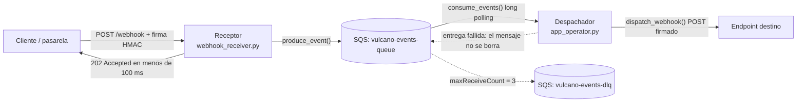

# VulcanoEventEngine — Webhooks HMAC, cola SQS y observabilidad asíncrona

TP-2 de **Programación para la Automatización II** (UPATECo) — Tec. Universitaria en Gestión de Infraestructura Cloud y DevOps.

Sistema de procesamiento de eventos de **Vulcano Pay**: recibe webhooks HTTP firmados (HMAC-SHA256), los encola en SQS de forma desacoplada y los despacha a los destinos de los clientes con reintentos y Dead Letter Queue. Todo con logs estructurados JSON no bloqueantes.

## Arquitectura



## Estructura del repositorio

```text
WebHooks/
├── .github/
│   └── pull_request_template.md  # checklist de cada Pull Request
├── src/
│   ├── vulcano_telemetry/
│   │   ├── __init__.py           # API pública del paquete
│   │   ├── exceptions.py         # excepciones semánticas
│   │   ├── sanitizer.py          # validadores para argparse
│   │   ├── core_sqs.py           # cliente Boto3 + productor/consumidor
│   │   ├── webhook_crypto.py     # HMAC-SHA256 (firma y verificación)
│   │   ├── webhook_receiver.py   # servidor HTTP receptor (FastAPI)
│   │   └── logging_engine.py     # logs JSON asíncronos + rotación Gzip
│   └── app_operator.py           # CLI: produce-sqs | start-receiver | start-dispatcher
├── tests/
│   ├── test_chaos.py             # firmas inválidas y mensajes venenosos
│   ├── test_forensic_log.py      # logs JSON, Gzip y serialización de ExceptionGroup
│   └── test_trazabilidad.py      # TraceId/MessageId/WebhookId de punta a punta
├── scripts/
│   └── setup_localstack.py       # crea las colas y la DLQ (idempotente)
├── tools/
│   ├── send_webhook.py           # envía un webhook firmado de prueba (202 / 401)
│   └── demo_sink.py              # destino de prueba que imprime lo que recibe
├── .gitignore                    # venv, caches, logs y archivos locales fuera del repo
├── requirements.txt              # boto3, fastapi, uvicorn, requests, pytest, httpx
├── pytest.ini                    # pythonpath = src, testpaths = tests
└── README.md
```

### Qué hace cada pieza

| Archivo | Responsabilidad |
|---|---|
| `webhook_receiver.py` | Recibe `POST /webhook`, verifica la firma HMAC antes de tocar el JSON, encola el evento y responde `202` con `message_id` y `trace_id` (o `401`/`400` si algo no cierra). |
| `webhook_crypto.py` | Firma y verifica `t=<timestamp>,v1=<hmac>` con `hmac.compare_digest` y ventana anti-replay de 300 s. |
| `core_sqs.py` | `produce_event()` publica con los atributos `TraceId`, `EventTopic` y `Timestamp`; `consume_events()` hace long polling y borra el mensaje solo si la entrega salió bien. |
| `app_operator.py` | CLI con tres subcomandos; el despachador firma y entrega cada evento y agrupa las fallas en un `ExceptionGroup` que se maneja con `except*`. |
| `logging_engine.py` | Logs JSON en UTC mediante `QueueHandler`/`QueueListener` (no bloquean el request), rotación con compresión Gzip y serialización completa de `ExceptionGroup`. |
| `exceptions.py` / `sanitizer.py` | Excepciones con nombre propio y validación de los argumentos del CLI. |
| `setup_localstack.py` | Crea la cola principal y la DLQ con `maxReceiveCount = 3` (se puede correr varias veces). |

## Requisitos

- Python >= 3.14 (`except*`, PEP 765)
- Docker (para LocalStack)
- Git

## Instalación

```bash
git clone https://github.com/prog-automatizacion-2-2026/WebHooks.git
cd WebHooks
python -m venv .venv
# Windows: .venv\Scripts\activate  |  Linux/macOS: source .venv/bin/activate
pip install -r requirements.txt
```

LocalStack y colas:

```bash
docker run --rm -d -p 4566:4566 --name vulcano-localstack localstack/localstack:3
python scripts/setup_localstack.py
```

## Variables de entorno

| Variable | Default | Uso |
|---|---|---|
| `VULCANO_AWS_ENDPOINT` | `http://localhost:4566` | Endpoint de LocalStack para Boto3 |
| `VULCANO_QUEUE_URL` | `http://localhost:4566/000000000000/vulcano-events-queue` | URL de la cola de eventos |
| `VULCANO_WEBHOOK_SECRET` | `vulcano-dev-secret-2026` | Clave HMAC de desarrollo (mínimo 16 caracteres) |

Sin secretos reales en el repositorio: estos valores son solo para desarrollo local.

## Uso (CLI)

```bash
python src/app_operator.py --help
python src/app_operator.py start-receiver     # servidor receptor (202 / 401)
python src/app_operator.py produce-sqs        # publica un evento de prueba
python src/app_operator.py start-dispatcher   # consume SQS y despacha
```

Flags globales: `--queue`, `--wait-time`, `--url`, `--secret` (validados por `sanitizer.py`).

## Demo local de punta a punta

Con LocalStack levantado y las colas creadas, en cuatro terminales (venv activado):

```bash
python src/app_operator.py start-receiver                                    # T1: receptor en :8000
python tools/demo_sink.py                                                    # T2: destino en :8001
python tools/send_webhook.py && python tools/send_webhook.py --invalid       # T3: 202 y 401
python src/app_operator.py start-dispatcher --url http://127.0.0.1:8001/     # T3: entrega al destino
```

El sink imprime `RECIBIDO: {"event": "payment_completed", "amount": 1500}` y la terminal del despachador muestra el mismo `TraceId` que devolvió el `202`. Pasar siempre `--url`: el valor por defecto apunta al propio receptor.

## Trazabilidad y logs

Cada evento lleva un **TraceId**: lo genera el receptor (o lo toma del header `X-Trace-Id` si viene) y lo devuelve en la respuesta `202`. Viaja como atributo del mensaje SQS (`TraceId`, `EventTopic` y `Timestamp`) y el despachador lo reenvía al destino en el header `X-Trace-Id`.

Cada línea de `vulcano_events.log` es un JSON con `timestamp` (ISO 8601 UTC), `logger`, `level`, `message`, `process_id`, `thread_name`, `TraceId`, `MessageId` y `WebhookId`. Los errores se guardan en el campo `exception`, con el `ExceptionGroup` completo: subexcepciones, notas de `add_note()` y causa encadenada. El CLI también muestra una versión corta en la terminal.

Para seguir un evento: `Select-String vulcano_events.log -Pattern <trace_id>` (PowerShell) o `grep <trace_id> vulcano_events.log`.

## Tests

```bash
python -m pytest        # 16 tests
```

| Archivo | Qué verifica |
|---|---|
| `test_chaos.py` | Firma alterada, timestamp vencido (ataque de replay) y mensaje venenoso que termina en la DLQ. |
| `test_forensic_log.py` | Formato JSON, timestamps UTC, compresión Gzip al rotar y serialización de `ExceptionGroup` (subexcepciones, notas y causa). |
| `test_trazabilidad.py` | El `TraceId` viaja del receptor a SQS y al despacho; un header `X-Trace-Id` inseguro se descarta; las fallas de entrega llevan su nota de causa. |

`test_poison_message_derivation_to_dlq` usa LocalStack si está levantado (si no, se omite) y publica un mensaje de prueba en la cola principal: purgar la cola antes de una demo.

## Cómo lo construimos (paso a paso)

1. **Planificación y andamiaje (18–19/10).** Se definió la arquitectura, se repartieron los módulos por integrante y se creó la estructura del repo con las ramas `main` y `develop`, una rama por integrante y la plantilla de Pull Request (PR #1).
2. **Desarrollo en paralelo (23–28/10).** Cada integrante trabajó en su rama `feature/…`:
   - Clelia: excepciones, sanitizador, cliente SQS y script de LocalStack.
   - Rene: firma HMAC, receptor FastAPI y tests de caos.
   - Francisco: motor de logs asíncrono JSON con Gzip y tests forenses.
   - Ariel: CLI `app_operator` con sus subcomandos y despacho firmado.
3. **Integración por Pull Request (28/10).** Se mergearon los PR #2 a #6 en `develop`. Luego se limpió el código antes de la entrega (dependencias de test, artefactos, TODOs y API pública del paquete; PR #7).
4. **Prueba contra LocalStack (28–30/10).** Al correr todo junto aparecieron fallas de integración y se corrigieron (PR #8): la redrive policy de la DLQ no era JSON válido, faltaba arrancar el listener de logs y el receptor no tomaba su configuración. Se fijó LocalStack Community `:3`, que no requiere token.
5. **Trazabilidad y observabilidad.** Se agregó el `TraceId` de punta a punta (header → atributo SQS → header del despacho), los campos `TraceId`/`MessageId`/`WebhookId` en cada línea de log y la serialización de `ExceptionGroup`. Ese estado se publicó como release **v1.0.0**.
6. **Endurecimiento de seguridad.** El `TraceId` recibido de afuera se valida (`[A-Za-z0-9._-]{1,64}`) antes de loguearlo o reenviarlo, para evitar inyección en los logs y en los headers.
7. **Demo y video (30/10).** Se sumaron `tools/send_webhook.py` y `tools/demo_sink.py` para mostrar el flujo completo (202, 401, entrega al destino y mismo `TraceId` en el log), y se grabó el video de la exposición.

Cada cambio entró por una rama propia y se mergeó a `develop` sin fast-forward (`--no-ff`). `main` solo recibe lo que ya se probó en `develop`.

## Entrega

- Versión: tag **`v1.0.0`** sobre `main`.
- Video de la demo: link publicado en el aula virtual.
- Comprobación rápida: `python -m pytest`, que debe dar 16 tests aprobados, y la [demo local](#demo-local-de-punta-a-punta).

## Equipo y roles

| Integrante | Rol | Módulos |
|---|---|---|
| Ariel (SM) | Integración, despachador y CLI | `app_operator.py`, `__init__.py`, estructura, README |
| Clelia | Robustez de entradas + mensajería SQS | `exceptions.py`, `sanitizer.py`, `core_sqs.py`, `scripts/` |
| Rene | Seguridad HMAC + receptor + caos | `webhook_crypto.py`, `webhook_receiver.py`, `tests/test_chaos.py` |
| Francisco | Observabilidad + forense | `logging_engine.py`, `tests/test_forensic_log.py` |

Flujo de trabajo: `main` (releases) / `develop` (integración) / una rama `feature/nombreapellido` por integrante; todo entra por Pull Request con revisión (la aprobación no bloquea el merge).
